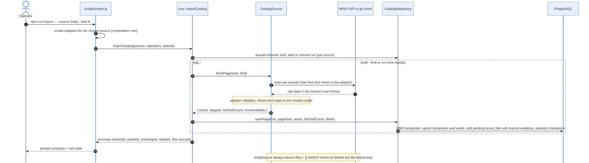
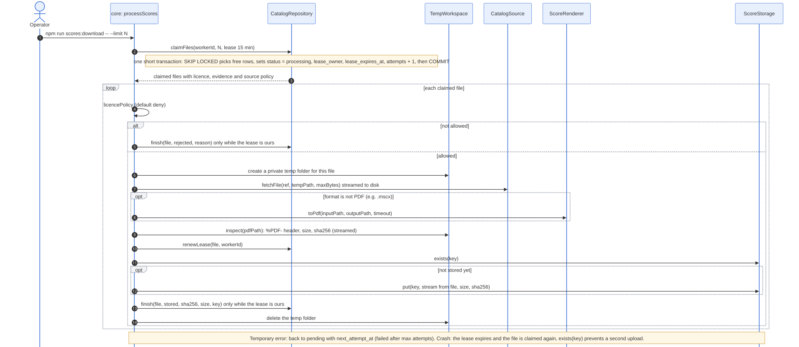
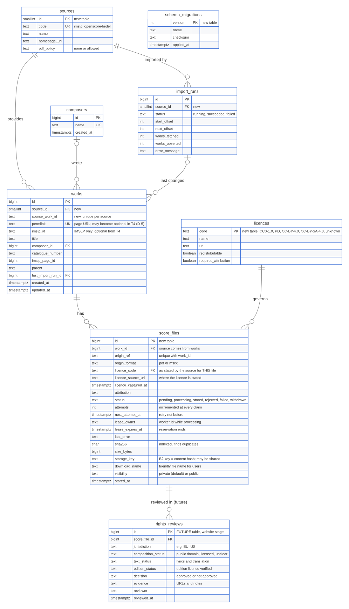

# Classical Sheet Music Finder: final proposed architecture

| | |
|---|---|
| **Status** | Proposed, awaiting approval. Nothing here is implemented yet. |
| **Version** | 2 (21 November 2026). Adds: file reservations with leases, retries and crash recovery; streaming and temporary files for large PDFs; per-file copyright and licence verification. Supersedes version 1. |
| **Applies to** | The evolution from the Week 1 importer (commit `b183872`) to multiple music sources, PDF storage in Backblaze B2 and a future website |
| **Implementation plan** | [Implementation_Roadmap.docx](Implementation_Roadmap.docx): stages T1-T8 |
| **Plain-English summary** | [ARCHITECTURE_OVERVIEW.txt](ARCHITECTURE_OVERVIEW.txt) |
| **Current (As-Is) architecture** | [Architecture section of the project README](../../README.md#architecture) |
| **Diagrams** | [diagrams/](diagrams/): editable Mermaid (`.mmd`), SVG and PNG |

## Contents

1. [Goals](#1-goals)
2. [Design principles](#2-design-principles)
3. [Architecture overview](#3-architecture-overview)
4. [Components and their responsibilities](#4-components-and-their-responsibilities)
5. [Ports and their adapters](#5-ports-and-their-adapters)
6. [Dependency direction](#6-dependency-direction)
7. [Data flow: importing a catalogue](#7-data-flow-importing-a-catalogue)
8. [Data flow: retrieving, processing and storing PDFs](#8-data-flow-retrieving-processing-and-storing-pdfs)
9. [Reservations, retries and crash recovery](#9-reservations-retries-and-crash-recovery)
10. [Large files: temporary files and streaming](#10-large-files-temporary-files-and-streaming)
11. [Copyright and licensing](#11-copyright-and-licensing)
12. [Data model and migrations](#12-data-model-and-migrations)
13. [Adding a new music source](#13-adding-a-new-music-source)
14. [Replacing storage, renderer or database](#14-replacing-storage-renderer-or-database)
15. [How we achieve loose coupling and high cohesion](#15-how-we-achieve-loose-coupling-and-high-cohesion)
16. [Runtime view and the future website](#16-runtime-view-and-the-future-website)
17. [What we deliberately do not build](#17-what-we-deliberately-do-not-build)
18. [Architectural decisions](#18-architectural-decisions)
19. [Open decisions](#19-open-decisions)
20. [Implementation roadmap](#20-implementation-roadmap)
21. [Diagram files](#21-diagram-files)

## 1. Goals

1. Add new music APIs or datasets **without changing the core** application logic.
2. Retrieve, check and store PDFs **independently of the music source**.
3. Store every legally redistributable PDF through **one shared storage adapter**
   (Backblaze B2, private bucket `classical-sheet-music-scores`, EU Central).
4. Keep **PostgreSQL** as the store for metadata, sources, licences and
   references to PDF files, with **versioned migrations**.
5. Keep the existing IMSLP importer, its data (10 works, 10 composers, 2 runs)
   and its 138 tests intact throughout.
6. Process files **safely when work is slow, interrupted or repeated**, with
   memory use that does not grow with file size.
7. Never show a file to the public without a **recorded check of its rights**.
8. Prepare for a future **public website** (search, preview, download) without
   building it now.

## 2. Design principles

| Principle | What it means here |
|---|---|
| **Ports and Adapters (Hexagonal Architecture)** | The core talks to the outside world only through small interfaces ("ports") that it defines. Each technology (IMSLP, git, MuseScore, B2, PostgreSQL, the local disk) lives in exactly one "adapter". |
| **Dependency Inversion** | All source-code dependencies point **towards** the core. The core never imports an adapter, `pg`, `fetch`, `fs` or `child_process`. |
| **Dependency injection by parameters** | `scripts/` creates the adapters and passes them into the core as arguments. No framework, no container. This already works today (`runImport({ client, parsePage, repo, pool })`). |
| **Separation of concerns** | Use cases decide *what* happens; adapters decide *how*; `src/cli/` handles command-line options and output only. |
| **High cohesion** | Each module has one reason to change: one source, one storage provider, one use case. |
| **Neutral data model** | The core works with "works", "files" and "licences", not with IMSLP field names. |
| **Safety by default** | Default-deny licence policy; IMSLP files never downloaded; private bucket; files private until reviewed; small default limits; every import and upload safe to repeat. |
| **Short transactions** | Database transactions last milliseconds. Long work (rendering, uploading) is protected by a recorded lease, never by an open transaction. |
| **Constant memory** | Files flow through a temporary folder and are streamed; no step holds a whole PDF in memory. |
| **No speculative complexity** | Build only what T1-T8 need; keep plain JavaScript, one process and one database. |

## 3. Architecture overview



Read the diagram from top to bottom:

1. **Driving side** starts the work: `scripts/` (the command-line entry points
   and the composition root), helped by `src/cli/`. A web app is added later.
2. **Core use cases** in `src/core/` contain the rules: importing a catalogue
   and processing score files.
3. **Ports** in `src/core/ports.js` are the contracts the core needs.
4. **Adapters** in `src/adapters/` implement the ports, one folder per technology.
5. **External systems**: IMSLP, the OpenScore Lieder git clone, Mutopia (later),
   MuseScore, Backblaze B2, PostgreSQL and the local disk (temporary files).

### Planned folder layout

```text
src/
  core/                      no I/O libraries, no adapters
    ports.js                 JSDoc descriptions of the five ports (no runtime code)
    errors.js                RunConflictError, OffsetMismatchError, LeaseLostError, ...
    importCatalog.js         use case: import pages from any CatalogSource
    processScores.js         use case: shared PDF pipeline with leases and retries
    licencePolicy.js         pure function: may this file be stored privately?
  adapters/
    imslp/                   imslpClient.js, imslpParser.js, imslpSource.js
    openscore/               openScoreLiederSource.js
    musescore/               museScoreRenderer.js
    storage/                 b2Storage.js, localStorage.js, memoryStorage.js
    workspace/               localWorkspace.js (temporary folders, streamed hashing)
    postgres/                db.js, repository.js, migrations.js
  cli/                       importOptions.js, downloadOptions.js, formatSummary.js, config.js
  web/                       (future)
scripts/                     import.js, download-scores.js, migrate.js, verify-import.js, fetch-sample.js
db/migrations/               0001_baseline.sql, 0002_sources.sql, 0003_score_files.sql
test/                        core/, adapters/, contracts/, db/, architecture.test.js
```

Existing files are moved with `git mv` in the stage that already changes them
(mainly T2), so their history is kept and nothing is moved just for tidiness.

## 4. Components and their responsibilities

| Component | Location | Responsibility | Depends on |
|---|---|---|---|
| Composition root | `scripts/*.js` | Reads configuration, creates adapters, calls a use case, sets the exit code | everything (only place allowed to) |
| CLI helpers | `src/cli/` | Parse options, read `.env` settings, format summaries | core |
| `importCatalog` | `src/core/` | Choose or resume a run, page through a source, save each page with its checkpoint, stop at `--limit` | ports, errors |
| `processScores` | `src/core/` | Claim files with a lease, apply licence policy, fetch, render if needed, verify, store, record the result; retry or give up safely | ports, `licencePolicy` |
| `licencePolicy` | `src/core/` | Pure decision for **private** storage: allowed or rejected, with a reason. Default deny. | nothing |
| Ports + errors | `src/core/` | The contracts and error types the core owns | nothing |
| `ImslpSource` | `src/adapters/imslp/` | HTTP client (timeouts, retries, 2 s crawl delay), parsing, IMSLP page checks; maps to the neutral model; **never offers files** | core (ports), `fetch` |
| `OpenScoreLiederSource` | `src/adapters/openscore/` | Reads the pinned git clone's metadata tables and `.mscx` files; states the licence per file | core, `fs` |
| `MuseScoreRenderer` | `src/adapters/musescore/` | Converts an `.mscx` file to a PDF file with the MuseScore 4 command line, with a timeout | core, `child_process` |
| `B2Storage` | `src/adapters/storage/` | Streams files to the private B2 bucket; checks existence; creates short-lived download links | core, `fetch`, `fs` |
| `LocalStorage`, `MemoryStorage` | `src/adapters/storage/` | Same contract for development and tests | core, `fs` |
| `LocalWorkspace` | `src/adapters/workspace/` | Creates and removes one temporary folder per file; reads the file header; computes size and SHA-256 by streaming; cleans up stale folders | core, `fs`, `crypto` |
| `PostgresRepository` | `src/adapters/postgres/` | All SQL: runs, works, composers, score files, leases; transactions; importer lock | core, `pg` |
| Migration runner | `src/adapters/postgres/` + `scripts/migrate.js` | Applies `db/migrations/*.sql` in order, records them in `schema_migrations` | `pg` |

## 5. Ports and their adapters

Ports are plain JavaScript objects described with JSDoc in `src/core/ports.js`,
written in the core's own terms. An adapter "implements" a port by providing
these functions; a shared **contract test** for each port proves that every
adapter behaves the same.

| Port | Functions (simplified) | Adapters |
|---|---|---|
| **CatalogSource** | `code`; `fetchPage({ start, limit })` returns `{ works, skipped, fetchedCount, moreAvailable }`; `fetchFile(fileRef, { destPath, maxBytes, signal })` **streams** the file to `destPath` and returns `{ format, sizeBytes }` | `ImslpSource` (offers no files), `OpenScoreLiederSource`, later `MutopiaSource`; `FakeSource` in tests |
| **ScoreRenderer** | `toPdf({ inputPath, format, outputPath, timeoutMs })`: file in, file out | `MuseScoreRenderer`; `FakeRenderer` in tests |
| **ScoreStorage** | `put(key, { filePath, sizeBytes, sha256, contentType, metadata })` **streams from the file**; `exists(key)`; `downloadUrl(key, { expiresInSeconds, downloadName })` | `B2Storage`, `LocalStorage`, `MemoryStorage` |
| **TempWorkspace** | `create(fileId)` returns a private folder; `inspect(path)` returns `{ sizeBytes, sha256, startsWithPdfHeader }` by streaming; `remove(folder)`; `removeStale(olderThan)` | `LocalWorkspace`; a temp-folder version in tests |
| **CatalogRepository** | runs: `acquireLock`, `findResumableRun`, `startRun`, `resumeRun`, `finishRun`; pages: `savePage`; files: `claimFiles`, `renewLease`, `finishFile`, `scheduleRetry`, `resetFailed` | `PostgresRepository` (created with its pool, so the core never sees a database connection) |

`fetchFile` is the "score fetcher" role: each source knows how to retrieve its
own files, so a separate fetcher port is not needed.

**The neutral work model** returned by every `CatalogSource`:

```js
{
  sourceWorkId,      // unique within the source (IMSLP: permlink)
  title,
  composerName,      // or null
  catalogueNumber,   // or null
  pageUrl,           // link to the work on the source's website, or null
  extra: { ... },    // optional source-specific values, e.g. IMSLP page id
  files: [ {         // IMSLP: always []
    originRef,           // URL or dataset path of this exact file
    format,              // 'pdf' or 'mscx'
    licenceCode,         // as stated by the source for THIS file, or 'unknown'
    licenceSourceUrl,    // where that statement can be checked
    attribution,         // text the licence requires us to show
  } ]
}
```

Errors that the core must recognise (another process owns this run; the lease
on a file was lost) are defined in `src/core/errors.js` and thrown by adapters,
so the core never imports an adapter to check an error type.

## 6. Dependency direction



- `scripts/` may import everything: it is the composition root.
- `src/cli/` and the future `src/web/` import only the core.
- `src/adapters/` import the core (to implement ports and throw core errors)
  and their own libraries.
- **`src/core/` imports nothing outside `src/core/`.** This is why reading files,
  hashing and temporary folders sit behind the `TempWorkspace` port.

The rule is enforced by `test/architecture.test.js`: a small test, using no
extra packages, that reads every file in `src/core/` and fails if it imports
`pg`, `fetch`, `fs`, `crypto`, `child_process`, `src/adapters/` or `src/cli/`.

## 7. Data flow: importing a catalogue



1. `scripts/import.js` reads `--source` (default `imslp`) and creates that
   source's adapter, the repository and the options.
2. `importCatalog` takes the importer lock and starts or resumes a run **for
   that source**.
3. For each page, the core asks `source.fetchPage(start, limit)`. The adapter
   does everything source-specific: HTTP and rate limiting (IMSLP) or reading
   the git clone (OpenScore), validation, and mapping to the neutral model.
4. `repository.savePage(...)` writes composers, works, **pending `score_files`
   rows with their licence evidence** and the run's checkpoint in **one
   transaction**.
5. The core stops at `--limit` records or when the source has no more results,
   and returns a summary.

Unchanged from today: pages are saved with their checkpoint atomically, runs
can be resumed, a second importer cannot run at the same time, and importing
the same works again creates no duplicates.

## 8. Data flow: retrieving, processing and storing PDFs



`npm run scores:download -- --limit N` (default 1) runs `processScores`:

1. **Claim with a lease** (section 9): up to N files become `processing`, owned
   by this worker until `lease_expires_at`.
2. **Licence policy** (pure function, default deny): the file's own licence must
   be redistributable, its evidence must be present, and the source must allow
   downloads (`sources.pdf_policy = 'allowed'`). Otherwise `rejected` with a reason.
3. **Fetch to disk**: `source.fetchFile(...)` streams the file into a private
   temporary folder and stops if it exceeds the size limit.
4. **Render** only if the file is not already a PDF (for example OpenScore's
   `.mscx`): `renderer.toPdf(...)` writes a PDF file next to it.
5. **Inspect**: `workspace.inspect(...)` streams the PDF once to check the
   `%PDF-` header, its size and its SHA-256.
6. **Renew the lease** before the upload.
7. **Store**: key `scores/pdf/<first 2 hex characters>/<sha256>.pdf`; upload,
   streamed from the file, only if `storage.exists(key)` is false.
8. **Record**: `finishFile(..., stored, ...)` succeeds **only if this worker
   still holds the lease**.
9. **Clean up** the temporary folder (always, also after errors).

IMSLP never reaches this pipeline: its `robots.txt` forbids bots from its file
download paths, so `ImslpSource` offers no files and `sources.pdf_policy` for
IMSLP is `none`.

## 9. Reservations, retries and crash recovery



### Why `FOR UPDATE SKIP LOCKED` alone is not enough

`SELECT ... FOR UPDATE SKIP LOCKED` locks a row **only while its transaction is
open**. Keeping one transaction open during a five-minute MuseScore render and
an upload would hold a database connection idle inside a transaction, keep row
locks for minutes, and tie the safety of the work to that one connection: if
the connection dropped, the lock would vanish while the work carried on.

### The lease mechanism

`SKIP LOCKED` is used only for the **instant of claiming**. The reservation that
protects the long work is a **lease** written into the row:

```sql
-- claimFiles: one short transaction, committed immediately
UPDATE score_files
SET status = 'processing', lease_owner = $worker,
    lease_expires_at = now() + make_interval(secs => $leaseSeconds),
    attempts = attempts + 1, updated_at = now()
WHERE id IN (
  SELECT id FROM score_files
  WHERE (status = 'pending' AND next_attempt_at <= now())
     OR (status = 'processing' AND lease_expires_at < now())   -- abandoned by a crashed worker
  ORDER BY id
  LIMIT $n
  FOR UPDATE SKIP LOCKED                                      -- two workers never claim the same row
)
RETURNING ...;
```

- **Worker id**: host name, process id and a random suffix.
- **Lease length**: longer than the slowest step plus a margin. Proposed:
  15 minutes, with a MuseScore timeout of 5 minutes and upload and download
  timeouts of a few minutes each (D-6).
- **Renewal**: `renewLease` extends the lease before the upload, and only if the
  row is still owned by this worker.
- **Ownership check on every write**: `finishFile` and `scheduleRetry` include
  `WHERE id = $id AND status = 'processing' AND lease_owner = $worker`. If no row
  is updated, the lease was lost (it expired and another worker claimed the
  file). The worker then stops working on that file and records nothing. This
  is harmless: storage keys are content hashes, so a second upload of the same
  PDF writes the same object.

### Retries

| Error kind | Examples | Result |
|---|---|---|
| Not allowed | licence not redistributable, no evidence, source policy `none` | `rejected` (final) |
| Permanent | not a PDF, larger than the limit, renderer reports invalid input | `failed` (final until the owner resets it) |
| Temporary | network error, timeout, B2 or source returns 5xx, renderer timeout | back to `pending` with `next_attempt_at = now() + backoff` |

- Backoff: 1, 2, 4, 8 and 16 minutes, capped at one hour.
- `attempts` is counted **at claim time**, so a file that crashes the worker
  every time cannot loop forever. After the maximum (proposed 5, D-6) it becomes
  `failed`.
- `npm run scores:download -- --retry-failed` (owner decision) puts `failed`
  files back to `pending` with `attempts = 0`.

### Crash recovery

| Crash happens... | What the next run sees | What it does |
|---|---|---|
| before the upload | `processing` with an expired lease | claims it again and starts over |
| after the upload, before recording | `processing` with an expired lease | claims it, re-creates the PDF, finds `exists(key)` true, records `stored` without uploading |
| while the database is unreachable | lease or retry not recorded | the lease expires; the file is claimed again later |
| leaving temporary files behind | stale folders in the workspace | `removeStale(olderThan = lease length)` deletes them at start-up |

`npm run verify:import` gains read-only checks: files per status, expired
leases, files at maximum attempts, and stored files whose key is missing.

## 10. Large files: temporary files and streaming

**Decision: every step works with files on disk and streams; no step holds a
whole PDF in memory.** Memory use stays roughly constant (stream buffers of
tens of kilobytes) whatever the file size.

| Step | How | Why |
|---|---|---|
| Fetch | `fetchFile` streams the download (or copies the dataset file) into the per-file temporary folder; aborts as soon as `maxBytes` is exceeded | A large or malicious file never fills memory |
| Render | MuseScore reads a file and writes a file | The MuseScore command line works with files anyway |
| Inspect | `TempWorkspace.inspect` reads the first bytes for `%PDF-`, then streams the whole file through SHA-256; size from the file system | The hash must be known **before** the upload because it is the storage key |
| Upload | `ScoreStorage.put` streams from the file with known size and checksum | Upload APIs need the length and benefit from a checksum; the file can be re-read if an upload is retried |
| Clean up | Folder deleted in a `finally` block; stale folders removed at start-up | Disk space does not leak |

Why temporary files instead of pure in-memory streams: the content hash
requires one full pass **before** the upload (a stream cannot be rewound), the
renderer is file-based, and a failed upload can be retried without fetching or
rendering again.

**Limits:** maximum file size `SCORES_MAX_BYTES` (proposed 100 MB, D-7); one file
at a time per worker; temporary folder under the operating system's temp
directory, configurable with `SCORES_TMP_DIR`. Streaming upload of very large
files may need B2's multi-part upload; the size limit keeps us within a single
upload, and the B2 adapter is the only place this would change.

## 11. Copyright and licensing



### Rights are checked per file, not per source

A score can involve several separate rights, and **all** of them must be clear
for a file to be shared:

1. **The music** (the composition): public domain depends on the composer's
   death date and on the country.
2. **The words** (for vocal music: the poet's text, and any translation): the
   lyricist and translator have their own rights.
3. **The edition** (engraving, transcription, arrangement, editorial work): the
   edition's own licence, as stated by the source for **that specific file**.
4. **The source's terms**: whether the source allows automated download and
   redistribution (for example, IMSLP's `robots.txt` excludes its file paths).

Copyright rules differ between countries, so "free to share" is always decided
**for specific countries** (D-8).

### What is recorded

At import, every file gets its own licence evidence (section 12): the licence
code **as stated for that file** (`unknown` if not stated), the URL where it is
stated, the date it was captured, and the attribution text. A source never
assigns one licence to all its files without checking each file's statement.

### Gate 1: private storage (automatic, T7)

`licencePolicy` allows a file into the **private** bucket only if its licence is
known and redistributable, its evidence is present, and the source allows
downloads. Everything else is `rejected`. Stored files have
`visibility = 'private'`.

### Gate 2: public availability (human review, future website stage)

No file becomes visible to website users until a person has recorded a review
in a `rights_reviews` table (added by a separate migration before the website).
The review covers, for each target country:

- the composition is public domain (composer's death year and the rule applied);
- the lyrics and any translation are public domain or licensed (lyricist and
  translator death years);
- the edition's licence is confirmed on the source's page for that file;
- the attribution text is correct.

Tools may **suggest** an answer (for example "composer died more than 70 years
ago"), but a person decides and records the evidence. Anything uncertain stays
private. Only then is `visibility` set to `public`.

### After publication

- The website shows only files with `status = 'stored'` and
  `visibility = 'public'`, with their licence and attribution.
- A **takedown** request sets the file to `withdrawn` immediately; links stop
  working because download links are short-lived and issued only for public
  files.
- If a re-import finds that a file's stated licence has changed, its
  `visibility` returns to `private` until it is reviewed again.

### Source specifics

- **IMSLP**: metadata only; no files are downloaded.
- **OpenScore Lieder**: the transcriptions are released under CC0. That covers
  OpenScore's work, not automatically the composition or the poem. Its
  maintainers have reported a few works wrongly assumed to be public domain, so
  Gate 2 reviews each song, including the poet's dates.

This architecture records and enforces decisions; it does not replace legal
advice. Before the website launches, the rules for the chosen countries should
be confirmed with a qualified adviser.

## 12. Data model and migrations



| Table | Purpose | Introduced |
|---|---|---|
| `schema_migrations` | Which migrations have been applied, with checksums | T1 (`0001`) |
| `composers`, `works`, `import_runs` | Existing tables, data kept | existing, baselined in `0001` |
| `sources` | One row per music source, with its `pdf_policy` | T4 (`0002`) |
| `works.source_id`, `works.source_work_id` | Which source a work came from; unique per source | T4 (`0002`) |
| `import_runs.source_id` | Runs are tracked per source | T4 (`0002`) |
| `licences` | Licence codes with `redistributable` and `requires_attribution`; includes `unknown` (not redistributable) | T5 (`0003`) |
| `score_files` | One row per file: origin, format, **licence evidence** (`licence_code`, `licence_source_url`, `licence_captured_at`, `attribution`), **processing state** (`status`, `attempts`, `next_attempt_at`, `lease_owner`, `lease_expires_at`, `last_error`), **result** (`sha256`, `size_bytes`, `storage_key`, `download_name`, `stored_at`) and `visibility` (private by default) | T5 (`0003`) |
| `rights_reviews` | Recorded human rights reviews per file and country | **Future** (website stage) |

Indexes on `score_files`: `(status, next_attempt_at)` for claiming,
`(lease_expires_at)` for expired leases, `sha256`, and a unique
`(work_id, origin_ref)`.

PDFs themselves are **never stored in PostgreSQL**: only their metadata and the
provider-neutral storage key.

**Migrations** are plain, versioned, forward-only SQL files in
`db/migrations/`, applied by our own small runner (no new package):

- each migration runs in one transaction and is recorded in
  `schema_migrations` with a checksum; an edited, already-applied migration is
  refused;
- an advisory lock prevents two runs at once;
- the existing database is **baselined**: if its tables already exist, `0001` is
  recorded as applied without running it;
- a `pg_dump` backup is taken before every migration of the real database;
- test schemas are built by running the migrations, so tests always use the
  real schema history.

## 13. Adding a new music source

Example: Mutopia.

1. Check the source's terms, licences and access rules, and record them.
2. Add `src/adapters/mutopia/mutopiaSource.js` implementing `CatalogSource`:
   map records to the neutral model and offer each file with **its own**
   licence statement and evidence URL.
3. Run the shared `sourceContract` test against it, with a recorded fixture
   (no network).
4. Add a migration that inserts the `sources` row (`code`, `name`,
   `homepage_url`, `pdf_policy`).
5. Register it in the composition root so `--source mutopia` works.

**Not touched:** the core, the PDF pipeline, leases and retries, the licence
policy, the workspace, B2 storage and the other adapters. If the source supplies
ready PDFs, the renderer is skipped automatically.

## 14. Replacing storage, renderer or database

| Replace | Work required | Why it stays small |
|---|---|---|
| Backblaze B2 with another provider | New adapter implementing `ScoreStorage`; run the storage contract test; copy existing objects | The database stores only our own keys (`scores/pdf/...`), never B2 file IDs or URLs; B2-specific details stay in `B2Storage` |
| MuseScore with another renderer | New adapter implementing `ScoreRenderer` | Sources hand over original formats; rendering is a separate, file-based port |
| Local temporary folders | New adapter implementing `TempWorkspace` | Only the workspace adapter touches the disk |
| PostgreSQL schema changes | New migration file | Versioned, tested migrations; SQL lives only in the Postgres adapter |

## 15. How we achieve loose coupling and high cohesion

The loose-coupling review of the current code found six couplings. Each one
is removed by a specific stage:

| # | Coupling in the current code | Resolution | Stage |
|---|---|---|---|
| C1 | `importer.js` imports error classes from `repository.js` | Errors owned by `src/core/errors.js` | T2 |
| C2 | Core checks IMSLP's page format (`metadata.start`, `moreResultsAvailable`) | IMSLP checks move into `ImslpSource`; core sees the neutral page | T3 |
| C3 | Data model uses IMSLP names (`imslpId`, `permlink`) | Neutral work model; IMSLP extras optional | T3, T4 |
| C4 | Core passes the database pool around | `createPostgresRepository(pool)` | T2 |
| C5 | `importer.js` also does option parsing, `.env` reading and output | Moved to `src/cli/` and the composition root | T2 |
| C6 | Module-level `defaultClient` in `imslpClient.js` | Removed | T2 |

What keeps it that way:

- **Interfaces owned by the core**, written in its own terms.
- **One adapter per technology**: a change in IMSLP's API, B2, MuseScore or the
  file system touches one folder.
- **Contract tests** prove adapters are interchangeable.
- **The architecture test** fails the build if the core imports infrastructure.
- **The `score_files` table** decouples importing from PDF processing in time,
  and its leases decouple workers from each other.

## 16. Runtime view and the future website



**Today and during T1-T8** everything runs on the owner's laptop (Node 24 via
mise, PostgreSQL in Docker, MuseScore, the OpenScore clone, temporary files),
plus two internet services: IMSLP (metadata only, 2 s crawl delay) and
Backblaze B2 (upload key restricted to one bucket).

**A future public website** adds `src/web/` as another driving adapter that
calls the same core:

- search and preview read PostgreSQL through a **read-only database role**;
- downloads use **short-lived links** created with a separate **read-only B2
  key**; the bucket stays private and keys never reach the browser;
- only files that are `stored` **and** `public` after a recorded rights review
  are offered, with their licence and attribution;
- a `withdrawn` status supports takedown requests;
- previews (first-page images) can be added later under `previews/` without
  touching any source.

Search, voice-category classification and composer name normalisation become
new core use cases with their own migrations; they reuse the existing ports.

## 17. What we deliberately do not build

- No dependency-injection container, no plugin auto-loading.
- No TypeScript just for interfaces; JSDoc is enough.
- No message queue: `score_files` with leases is the queue.
- No lease heartbeat thread: one renewal before the upload, plus timeouts that
  are shorter than the lease.
- No parallel workers until one worker proves too slow (the design already allows it).
- No microservices or separate deployables.
- No automatic publication: public visibility always requires a recorded review.
- No full IMSLP import without the owner's explicit approval.

## 18. Architectural decisions

| ID | Decision | Reason |
|---|---|---|
| AD-1 | Ports and Adapters in plain JavaScript; dependencies passed as parameters | Testable and replaceable without a framework |
| AD-2 | The core owns its ports and error types; dependency rule enforced by a test | Dependency Inversion that cannot silently erode |
| AD-3 | Versioned, forward-only SQL migrations with our own runner; `pg_dump` before migrating | Keeps "only `pg`"; data protected; code we can explain |
| AD-4 | Neutral work model; source-specific values optional | New sources without core changes |
| AD-5 | IMSLP is metadata-only | IMSLP `robots.txt` disallows bot access to file paths |
| AD-6 | Content-addressed storage keys; database stores only provider-neutral keys | Idempotent uploads, deduplication, storage provider can change |
| AD-7 | Rendering is its own, file-based port | Sources stay simple; renderer replaceable |
| AD-8 | `score_files` is the hand-off between import and processing | Decoupled in time; no queue software |
| AD-9 | Default-deny licence policy for private storage | Only files with a known redistributable licence are stored |
| AD-10 | Private bucket; future downloads via short-lived links and read-only credentials | Control over what is distributed |
| AD-11 | Reservation by **lease** (owner and expiry in the row), claimed with `SKIP LOCKED` in a short transaction; every write checks ownership | Safe during long work and after crashes; no long transactions |
| AD-12 | Files flow through a per-file temporary folder and are streamed; `TempWorkspace` port | Constant memory; hash before upload; retry without re-fetching |
| AD-13 | Rights recorded **per file**; Gate 1 automatic for private storage, Gate 2 recorded human review per country before public visibility | Editions, music and lyrics can have different rights; nothing is published by accident |

## 19. Open decisions

| ID | Question | Recommendation | Needed before |
|---|---|---|---|
| D-1 | B2 access: B2's native API via `fetch`, or the AWS S3 SDK? | Native API: no new dependency; avoids SDK checksum-header issues | T6 |
| D-2 | Install MuseScore 4 on the laptop? | Yes, needed to render OpenScore `.mscx` files | T8 |
| D-3 | Where to keep the OpenScore Lieder clone? | Sibling folder outside the repository, pinned to a commit | T8 |
| D-4 | Stop running `db/schema.sql` automatically on a new Docker volume? | Yes; use `npm run migrate` instead | T1 |
| D-5 | Make `works.permlink` optional for sources without a page URL? | Yes, keep it unique (several NULLs are allowed) | T4 |
| D-6 | Lease length and maximum attempts | 15-minute lease, 5 attempts, backoff 1-16 minutes | T7 |
| D-7 | Maximum file size | 100 MB (`SCORES_MAX_BYTES`) | T7 |
| D-8 | Which countries must a file be free in before it is shown publicly? | Decide before the website stage; at least the owner's own country plus the main audience | Website stage |

## 20. Implementation roadmap



| Stage | Content | Changes the database? |
|---|---|---|
| T1 | Migration runner and `0001` baseline | Records `schema_migrations` only |
| T2 | Decouple the core, no behaviour change | No |
| T3 | Neutral work model, `CatalogSource`, `ImslpSource` | No |
| T4 | Migration `0002`: sources | Yes, additive, existing rows back-filled |
| T5 | Migration `0003`: licences, score files with leases, retries, licence evidence and visibility | Yes, new tables only |
| T6 | `ScoreStorage` (streamed) and the B2 adapter | No |
| T7 | `processScores` with leases, retries, crash recovery, `TempWorkspace` and the licence policy | No |
| T8 | OpenScore Lieder, file-based MuseScore renderer, one-PDF end-to-end test | No (data only) |

Stages run in number order, one per session, with a commit before each. The
`rights_reviews` table and Gate 2 belong to the website stage, after T8. Full
details are in [Implementation_Roadmap.docx](Implementation_Roadmap.docx).

## 21. Diagram files

All diagrams are in [diagrams/](diagrams/), each as editable Mermaid source
(`.mmd`), SVG and PNG.

| Diagram | Files |
|---|---|
| 1. Ports and Adapters overview | `01-hexagonal-architecture.mmd` / `.svg` / `.png` |
| 2. Dependency rule | `02-dependency-rule.mmd` / `.svg` / `.png` |
| 3. Import data flow | `03-import-data-flow.mmd` / `.svg` / `.png` |
| 4. PDF processing flow with leases and temporary files | `04-pdf-processing-flow.mmd` / `.svg` / `.png` |
| 5. Data model | `05-data-model.mmd` / `.svg` / `.png` |
| 6. Implementation roadmap | `06-implementation-roadmap.mmd` / `.svg` / `.png` |
| 7. Runtime today and in the future | `07-runtime-today-and-future.mmd` / `.svg` / `.png` |
| 8. Life of a score file (new in v2) | `08-score-file-lifecycle.mmd` / `.svg` / `.png` |
| 9. Rights clearance in two gates (new in v2) | `09-rights-clearance.mmd` / `.svg` / `.png` |

To view them in VS Code, click an `.svg` or `.png` file, or open this document
and press **Ctrl+Shift+V**.
